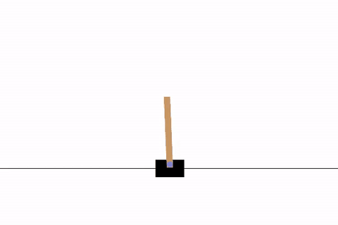
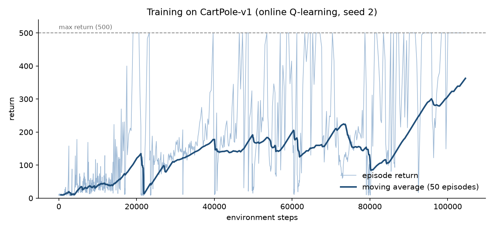

# cartpole-q-learning

A neural network learns to balance a pole on a moving cart (Gymnasium's **CartPole-v1**) with plain online Q-learning: no replay buffer, no target network, one gradient step per environment step.



*A greedy evaluation episode of the final network. The pole starts slightly tilted and already moving; the agent catches it, stabilizes it and keeps it up for the full 500 steps, as in all 10 recorded episodes. [Video of the 10 evaluation episodes](media/evaluation_10_episodes.mp4).*

## The problem

At every step the agent sees 4 numbers (cart position, cart velocity, pole angle, pole angular velocity) and chooses one of 2 actions: push the cart left or right. It gets +1 for every step the pole stays up and the cart stays on the track, and an episode is capped at 500 steps, so the maximum return is 500.

Every episode starts from a random state: the 4 values are drawn uniformly in [−0.05, 0.05], so the pole is already slightly tilted (up to about 3°) and moving when the episode begins. The agent first has to catch the falling pole and stabilize it, then keep it balanced without drifting off the track.

## The method

The agent learns an action-value function Q(s, a), the expected discounted return of taking action a in state s and acting well afterwards. Q is approximated by a small network:

```
state (4) ──▶ Linear 4→128 ──▶ ReLU ──▶ Linear 128→2 ──▶ Q(s, left), Q(s, right)
```

Training is one-step Q-learning, applied online:

1. **Act** ε-greedily: a random action with probability ε, otherwise the action with the highest Q-value. ε starts at 0.1 and decays linearly over the 300,000-step budget.
2. **Step** the environment and observe (s, a, r, s', done).
3. **Compute the TD target** with the same network, without gradient:

   y = r + γ · (1 − done) · max<sub>a'</sub> Q(s', a'),  with γ = 0.99

4. **Update** the network with one Adam step (learning rate 1e-3) on the squared error (Q(s, a) − y)².

Each transition is used once and then thrown away. Only terminations stop the bootstrap: when an episode is cut at 500 steps (truncation), the target still bootstraps, since the pole had not fallen.

## Results

Training uses seed 2 and stops early once the last 10 episodes all reach 500. That happened after 104,568 environment steps (1,152 episodes, about a minute on CPU). The agent was then evaluated greedily (ε = 0).



| | |
|---|---|
| Evaluation, 10 recorded episodes (random starts) | 9 × 500, 1 × 475 (mean **497.5** / 500) |
| Evaluation, 20 episodes with fixed starting states | **20 × 500** |
| First training episode reaching 500 | after 19k steps |

The curve shows what this simple method does well and where it breaks:

- It **does learn**: the average return goes from about 10 to the 500-step cap, and the final policy balances the pole for the whole episode.
- It is **unstable**. The policy repeatedly collapses (around 21k, 40k, 60k and 80k steps) before recovering. Without a replay buffer, consecutive updates use highly correlated transitions from the current episode, so the network keeps overwriting what it learned elsewhere in the state space. And because the target is computed with the network being trained, every update also moves its own target.

### Same code, other seeds

The same training run with four different seeds shows how much the outcome depends on luck:

| Seed | Steps before early stop | Greedy evaluation (20 episodes) |
|---|---|---|
| 1 | 149,523 | mean 228.4, 0 × 500 |
| 2 | 104,568 | mean 500.0, 20 × 500 |
| 3 | 132,104 | mean 500.0, 20 × 500 |
| 4 | 84,783 | mean 381.0, 1 × 500 |

All four runs met the stopping criterion (10 training episodes in a row at 500), yet seeds 1 and 4 fail without exploration. The criterion is measured with ε > 0, so it says little about the greedy policy, and with the network changing at every step, the policy at the moment training stops can be a lucky snapshot.

### Continued training

`continue_training.py` keeps training the seed-2 network for 200,000 more steps with the same update rule (ε restarts at 0.05 and decays to 0), and evaluates it greedily every 10,000 steps on 50 new episodes:

| Extra steps | Episodes at 500 (out of 50) | Mean return |
|---|---|---|
| 0 (end of the notebook run) | 46 | 498.0 |
| 10,000 | **50** | **500.0** |
| 20,000 | 0 | 188.8 |
| 30,000 to 150,000 | 50 at every evaluation | 500.0 |
| 160,000 | 0 | 299.8 |
| 170,000 to 200,000 | 50 at every evaluation | 500.0 |

More training gets the network to a policy that balances the pole in every evaluation episode, and 18 of the 21 evaluations are perfect. But even late in training, with almost no exploration left, a few thousand single-transition updates are enough to break the policy completely (0 out of 50 at 20k and 160k) before it recovers. The best network (after 10,000 extra steps) is saved as `models/q_network_continued.pt` and is the one shown in the video.

These two problems are exactly what DQN fixes with an experience replay buffer (decorrelated mini-batches) and a target network (a stable target). They are both used in my follow-up project, [trackmania-dqn](https://github.com/sasam007/trackmania-dqn), where a Double DQN learns to drive a TrackMania track.

## Running it

```
pip install -r requirements.txt
jupyter notebook cartpole_q_learning.ipynb
```

Run the cells in order. Training takes about a minute; the evaluation cell records the 10 greedy episodes to `qlearning_cartpole_videos/`. All random number generators are seeded (`SEED = 2`), so training reproduces the run above; change `SEED` to try others. The trained weights are in `models/q_network.pt`.

To continue training from those weights (a few minutes on CPU, also seeded and reproducible):

```
python continue_training.py
```

## Files

```
cartpole_q_learning.ipynb       the full experiment: environment, network, training loop, evaluation
continue_training.py            continues training the notebook's network, with periodic greedy evaluation
models/
  q_network.pt                  weights at the end of the notebook run (seed 2)
  q_network_continued.pt        best network from continued training (+10,000 steps)
  continued_training.json       evaluation results of the continued training
media/
  evaluation_episode.gif        one greedy evaluation episode of the final network (500 steps)
  evaluation_10_episodes.mp4    the 10 recorded evaluation episodes of the final network, back to back
  training_returns.png          episode returns during training
```
